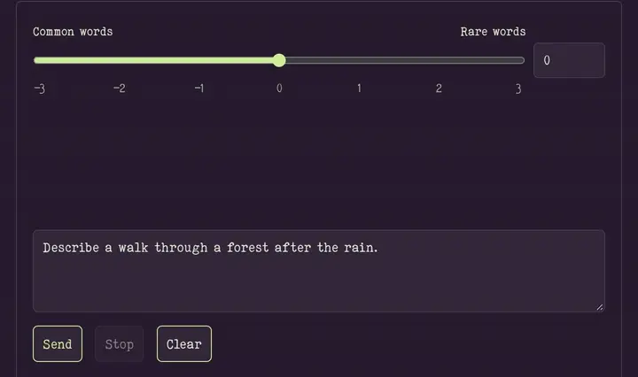
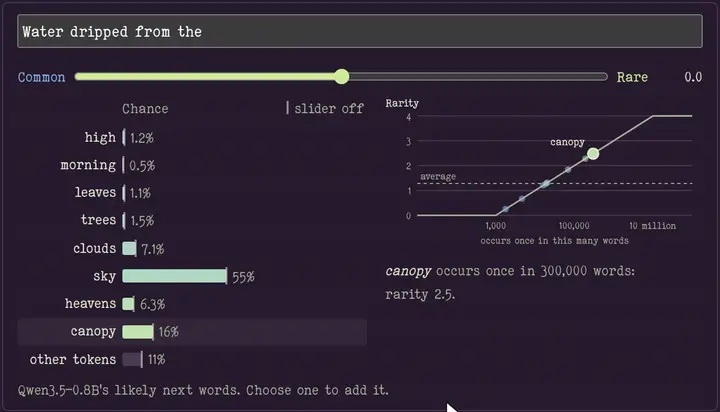

# lexical sophistication

[lexical sophistication](https://gustavecortal.com/lexical-sophistication/) is a sampler that steers a language model toward common or rare words by how often they appear in English. This repository runs it from the command line on Qwen3.5-0.8B, the model of the [live demo](https://gustavecortal.com/lexical-sophistication/).

<p align="center">
  <a href="https://gustavecortal.com/lexical-sophistication/"></a>
</p>

## Quick start

```bash
git clone https://github.com/gustavecortal/lexical-sophistication.git
cd lexical-sophistication
npm ci
npx lexical-sophistication "Describe a walk through a forest after the rain." --strength 3
```

The first run downloads the demo's 4-bit ONNX export of the model (0.58 GB) into `~/.cache/lexical-sophistication`, unless the Hugging Face cache holds it. Replies then run on the CPU, at about 15 tokens a second on 16 threads. `--strength` goes from -3 (common words) to 3 (rare words), and 0 gives the model's own reply. The other options (`--seed`, `--max-tokens`, `--temperature`, `--top-k`, `--top-p`, `--presence`) default to the demo's settings.

## How it works

Each word gets a rarity from how often it appears in [wordfreq](https://github.com/rspeer/wordfreq)'s English list: 6 minus its Zipf frequency, from 0 to 4. Words more common than 1 in 1,000, such as *the*, get 0. *Sky*, seen once in 19,000 words, gets 1.3, and *canopy*, once in 300,000, gets 2.5.

At each step, the model's most likely next tokens (20 by default) gain or lose logits in proportion to the strength and to how far their word's rarity is from the average, 1.28 (about that of *sky*). At positive strengths rarer words gain and more common ones lose. Words of rarity 0 get no bonus or penalty. A token that only starts a word, like *sky*, which could still become *skyline*, counts as the mean of the words it could become, weighted by their frequency. The model's own sampler then draws from the adjusted tokens.

<p align="center">
  <a href="https://gustavecortal.com/lexical-sophistication/"></a>
</p>

## Rebuild the word list

```bash
uv run scripts/export_frequencies.py data/frequency-en.json
node scripts/build_table.mjs data/frequency-en.json data/frequency-en.bin
```

This rewrites `data/frequency-en.bin` from wordfreq 3.1.1 in under a minute, identical to the live demo's table. `npm test` checks the sampler, the model's next tokens and a 48-token reply at strength 3 against the demo.

## License

The code is under the [MIT license](LICENSE). `data/frequency-en.bin` is derived from wordfreq's data by Robyn Speer, under [CC BY-SA 4.0](https://creativecommons.org/licenses/by-sa/4.0/).
